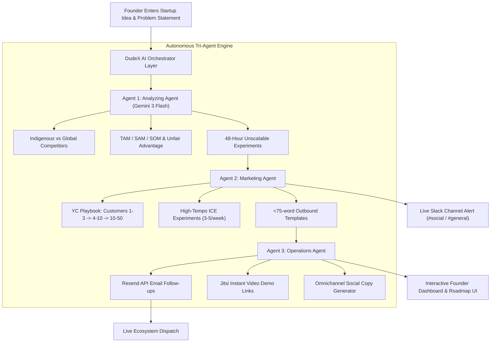

# 🚀 DudeX AI: Hackathon Presentation & Architecture Blueprint
**Event**: Google Buildathon / Hackathon  
**Project**: DudeX AI — The Autonomous Startup Execution Operating System  
**Tagline**: *Turning raw startup ideas into validated, scalable businesses with an autonomous multi-agent co-founder team.*  
**Live Repository**: [https://github.com/Dudexai/Google_Buildathon_DudeX_AI](https://github.com/Dudexai/Google_Buildathon_DudeX_AI)

---

## 📑 Slide Deck Index (12-Slide Master Pitch Structure)

- **Slide 1**: Title & Vision — The Autonomous AI Co-Founder
- **Slide 2**: The Problem — The Execution Valley of Death
- **Slide 3**: The Solution — DudeX AI: Startup Execution Operating System
- **Slide 4**: Core Innovation — The 3-Agent Autonomous System
- **Slide 5**: The Intelligence Playbooks — Embedded YC, HubSpot & Sean Ellis Frameworks
- **Slide 6**: Workflow Diagram — End-to-End Founder Journey
- **Slide 7**: System Architecture Diagram — Full-Stack Google Cloud & Gemini Dual-Engine
- **Slide 8**: Live Ecosystem Integrations — Slack, Resend, Jitsi & Google Grounding
- **Slide 9**: Google Cloud & Gemini Synergy — $300 Credit & Scale-to-Zero Cloud Run
- **Slide 10**: Competitive Moat — Why DudeX AI Wins Over Generic LLMs
- **Slide 11**: Business Model & Go-to-Market
- **Slide 12**: Demo Walkthrough Script & Hackathon Judges Q&A

---

## 🎯 Slide 1: Title & Executive Summary

### Elevator Pitch
> *"90% of startups fail not because they cannot write code, but because they build things nobody wants, target the wrong initial customers, and lack an experienced operational team. **DudeX AI** is an autonomous multi-agent operating system that serves as your on-demand AI co-founder team—conducting instant competitor reconnaissance with Google Gemini 3 Flash, executing tactical YC customer acquisition playbooks, generating instant video discovery calls, and alerting teams in Slack in real-time."*

- **Product Category**: Agentic AI / Startup Operations / Developer & Founder Tooling
- **Target Audience**: Solo founders, hackathon builders, early-stage incubators, university entrepreneurs, and small agile teams.
- **Key Metric**: Accelerates the 0-to-1 startup validation phase from **6 weeks down to 48 hours**.

---

## ⚠️ Slide 2: The Problem — The "Execution Valley of Death"

1. **Founder Isolation & Decision Paralysis**: Solo founders spend 70% of their time agonizing over what to do next instead of talking to real users.
2. **Generic, Hallucinated Advice**: Standard LLMs give fluffy, ungrounded advice like *"create great content"* without knowing local competitors or real-world unscalable sales tactics.
3. **Fragmented SaaS Sprawl**: A founder currently has to stitch together 7+ different paid tools: Notion for notes, Jira for tasks, PitchBook/Crunchbase for competitors, Apollo for leads, Calendly for meetings, Mailchimp for emails, and Slack for notifications.
4. **Execution Blind Spots**: Founders jump immediately to automated cold spamming rather than working warm networks or doing unscalable manual discovery.

---

## 💡 Slide 3: The Solution — DudeX AI Platform

**DudeX AI is a unified startup execution cockpit powered by Google's latest Gemini models.**

```
   ┌──────────────────────────────────────────────────────────────┐
   │                   DUDEX AI PLATFORM SUITE                    │
   ├──────────────────────────────┬───────────────────────────────┤
   │ 1. AI Execution Roadmap      │ 30-Day progressive plan       │
   │ 2. Tri-Agent Dual Engine     │ Analyzing, Marketing, Ops     │
   │ 3. Real-Time Community Hub   │ Peer collaboration & chat     │
   │ 4. Strategic Analytics Radar │ Quantitative progress metrics │
   │ 5. Automated Communications  │ Email, Slack, Video Calls     │
   └──────────────────────────────┴───────────────────────────────┘
```

---

## 🤖 Slide 4: The 3-Agent Autonomous System

Instead of a single monolithic prompt, DudeX AI delegates tasks across three specialized autonomous agents:

### 1. Agent 1: Analyzing Agent (Market & Competitor Intelligence)
- **Role**: Competitive analyst and market researcher.
- **Capabilities**:
  - Automatically segregates competitors into **Indigenous** (domestic/regional, e.g., India) and **External** (global market leaders).
  - Pinpoints each competitor's localized strengths and structural vulnerabilities.
  - Formulates the startup's **Unfair Advantage** (the 10x differentiator).
  - Calculates quantitative **TAM / SAM / SOM** market sizing.
  - Designs **48-Hour Unscalable Validation Experiments** with clear success metrics.

### 2. Agent 2: Marketing & Growth Agent (Outbound Engine)
- **Role**: Head of Growth and Outbound Strategist.
- **Capabilities**:
  - Determines the target ICP's daily workflow and identifies where they spend time (trade shows, job sites, Reddit, niche Slack groups).
  - Designs customer acquisition tactics stratified by stage:
    - **Customers 1–3**: Warm network, former colleagues, 2nd-degree LinkedIn intros.
    - **Customers 4–10**: Unscalable manual outreach, Reddit DMs, founder micro-dinners, walking conference floors.
    - **Customers 10–50**: Scaled Apollo outreach sequences.
  - Generates cold email copy (<75 words, single CTA, advice/mentorship framing).
  - Calculates Sean Ellis **ICE Scores** (Impact, Confidence, Ease) for weekly growth tests.
  - Dispatches formatted markdown **Growth Alerts directly to Slack**.

### 3. Agent 3: Operations & Communications Agent
- **Role**: Executive Assistant and Chief of Staff.
- **Capabilities**:
  - Crafts transactional email follow-ups and investor updates via **Resend API**.
  - Creates instant **Jitsi Video Meeting links** for user interviews and customer demos.
  - Coordinates team calendar entries with **Supabase database**.
  - Drafts platform-native social copy: LinkedIn thought leadership posts, viral Twitter/X threads, and DudeX community announcements.

---

## 📚 Slide 5: The Intelligence Playbooks Embedded in DudeX AI

DudeX AI is not a generic prompt wrapper. It directly embeds the proven operational frameworks of world-class startup leaders:

| Master Playbook | Source Authority | Embedded Tactical Rule in DudeX AI |
| :--- | :--- | :--- |
| **Tactics of First 10 Customers** | **Max** *(Visiting Partner, Y Combinator)* | • Answer *"Where does the buyer spend their day?"* before picking tools.<br>• Customers 1–3 must come from warm network.<br>• In-person closing > Zoom calls.<br>• Outbound cold emails must be **under 75 words** with a single CTA.<br>• 1-minute out-loud sanity check before sending. |
| **Scaling Go-to-Market & Velocity** | **Brian Halligan** *(Founder & Executive Chairman, HubSpot)* | • **GEO (Generative Engine Optimization)**: Optimizing for AI answer engines (ChatGPT, Gemini, Perplexity) instead of traditional SEO.<br>• **Quarterly Decision Velocity**: Speed over perfection.<br>• **DRIs (Directly Responsible Individuals)** over consensus committees.<br>• **LOCKS Framework**: Focus on high-retention customer segments. |
| **High-Tempo Growth Loop** | **Sean Ellis** *(Author, Hacking Growth)* | • High-tempo testing rhythm: **3 to 5 actionable tests per week**.<br>• **ICE Prioritization**: $\text{ICE Score} = \text{Impact} \times \text{Confidence} \times \text{Ease}$.<br>• Focus on complete AARRR Pirate Metrics funnel. |

---

## 🔄 Slide 6: System Workflow Diagram

### End-to-End Founder Execution Journey



---

## 🏗️ Slide 7: Technical Architecture Diagram

```mermaid
graph TB
    subgraph ClientLayer["Frontend Client (React 18 + Vite + Tailwind)"]
        UI["Modern Dashboard UI (Shadcn / Radix / Lucide)"]
        Chat["Startup AI Mentor Chat"]
        Market["Market Analysis & Competitor View"]
        Comm["Real-Time Community Hub"]
    end

    subgraph ApiGateway["FastAPI Application Server (Python 3.11)"]
        Router["FastAPI Route Controller"]
        Orchestrator["Dual-Engine Agent Orchestrator"]
        Sched["APScheduler Background Engine"]
    end

    subgraph AIIntelligence["Dual-Engine LLM Fallback Architecture"]
        Gemini["Primary: Google Gemini 3 Flash\n(Google AI Studio / Vertex AI)"]
        Grounding["Google Search Grounding Engine"]
        OpenRouter["Fallback: OpenRouter AI Engine\n(Zero Downtime Failover)"]
    end

    subgraph DataIntegrations["Persistence & External Services"]
        Supabase["Supabase Cloud (PostgreSQL + Realtime WebSockets)"]
        SQLite["Local Strategy Database (Deterministic Engine)"]
        Slack["Slack API Bot (Dudexai Workspace: buildathon_api)"]
        Resend["Resend API (Transactional Email Dispatch)"]
        Jitsi["Jitsi Meet (Instant Video Interview Links)"]
    end

    subgraph CloudInfra["Google Cloud Platform Infrastructure"]
        GCPRun["Google Cloud Run (Serverless Container - Scales to Zero)"]
        GCR["Google Artifact Registry (Docker Images)"]
    end

    UI --> Router
    Chat --> Router
    Market --> Router
    Comm --> Router

    Router --> Orchestrator
    Orchestrator -->|Primary Request (Fast ~8s)| Gemini
    Gemini -.-> Grounding
    Gemini -->|Fallback on Rate-Limit/Spike| OpenRouter

    Router --> Supabase
    Router --> SQLite
    Router --> Slack
    Router --> Resend
    Router --> Jitsi

    ApiGateway -.-> GCPRun
    ClientLayer -.-> GCPRun
```

---

## ⚡ Slide 8: Live Integrations & Ecosystem Connectivity

DudeX AI does not live in an isolated vacuum; it is wired into real founder communications channels:

1. **Slack Bot Integration (`buildathon_api`)**:
   - Authenticated directly to `dudexai.slack.com`.
   - Automatically dispatches high-priority **Growth Alerts**, weekly experiment schedules, and competitor updates directly to `#social` and `#general` channels.
2. **Google Search Grounding**:
   - Enables real-time market discovery so the Analyzing Agent surfaces genuine existing companies rather than hallucinated dummy brands.
3. **Resend Email Engine**:
   - Triggers personalized invite links, investor update emails, and user interview confirmations.
4. **Jitsi Video Call Generator**:
   - One-click instant creation of secure, zero-download video conference rooms (`https://meet.jit.si/dudex-...`) for founder-to-customer discovery sessions.

---

## ☁️ Slide 9: Google Cloud & Gemini Alignment ($300 Credit Optimization)

| GCP Component | Purpose & Implementation | Cost & Optimization Strategy |
| :--- | :--- | :--- |
| **Google Cloud Run** | Hosts containerized FastAPI backend and React frontend. | **Scale-to-Zero**: Inactive containers cost \$0. Zero idle costs; perfectly utilizes Google's \$300 free trial credits. |
| **Google Gemini 3 Flash** | Powers all 3 autonomous agents with high-speed reasoning. | Lowest latency and cost-per-token with industry-leading context window. |
| **Google Search Grounding** | Grounding market data with Google's live search index. | Eliminates the need for expensive third-party scraping APIs like SerpAPI or Tavily. |
| **Artifact Registry** | Container image management via automated build scripts (`deploy_gcp.bat`/`.sh`). | Fast, secure deployment pipeline within Google Cloud. |

---

## 🛡️ Slide 10: Competitive Advantage & Moat

| Dimension | Generic ChatGPT / Claude | Fragmented Tools (Notion + Apollo) | DudeX AI |
| :--- | :--- | :--- | :--- |
| **Domain Grounding** | Generic conversational prose. | Manual data entry and tracking. | **Embedded YC & HubSpot playbooks** tailored to early validation. |
| **Competitor Research** | Often hallucinates or misses local players. | Requires \$500/mo PitchBook or Crunchbase. | **Automatic Indigenous vs Global categorization** with unfair advantage synthesis. |
| **Actionability** | Advice without execution tools. | Requires manual copy-pasting across 5 apps. | **Instant email, video link, and Slack dispatch.** |
| **Fault Tolerance** | Single provider point of failure. | Dependent on disparate tools. | **Dual-engine (Gemini + OpenRouter) zero-downtime failover.** |
| **Pricing for Founders** | \$20/mo per seat with no integrations. | \$300+/mo combined software stack. | **Accessible, open, and scales with Google Cloud free tier.** |

---

## 💰 Slide 11: Business Model & Monetization Strategy

```
                          ┌─────────────────────────┐
                          │   FREEMIUM TIER ($0)    │
                          │ • 30-Day Project Plan   │
                          │ • Basic Gemini Analysis │
                          │ • Community Hub Access  │
                          └────────────┬────────────┘
                                       │
                                       ▼
                          ┌─────────────────────────┐
                          │     PRO TIER ($29/mo)   │
                          │ • Unlimited Multi-Agents│
                          │ • Live Slack Bot Alerts │
                          │ • Video & Email Autom.  │
                          │ • Deep Competitor Ground│
                          └────────────┬────────────┘
                                       │
                                       ▼
                          ┌─────────────────────────┐
                          │   INCUBATOR / ENTERPRISE│
                          │ • Cohort Analytics     │
                          │ • Custom CRM Connectors │
                          │ • Dedicated Cloud Run   │
                          └─────────────────────────┘
```

---

## 🎤 Slide 12: Judge Demo Walkthrough Script (3-Minute Hackathon Pitch)

### 0:00 - 0:30: The Hook & Problem
> *"Judges, imagine you have a brilliant startup idea today. What is your next step? Usually, you waste two weeks asking ChatGPT generic questions, building features nobody asked for, and struggling to find your first 10 customers. We built **DudeX AI** to eliminate this failure loop."*

### 0:30 - 1:15: Live Demo — Analyzing Agent (Agent 1)
> *"Let's input a real problem: 'AI automated cold outreach tool for tech startups.' In under 10 seconds, our **Analyzing Agent powered by Gemini 3 Flash** categorizes both indigenous local competitors and global giants. It outlines our unfair advantage and gives us three concrete, unscalable experiments to run in the next 48 hours."*

### 1:15 - 2:00: Live Demo — Marketing Agent (Agent 2) & Slack Integration
> *"Next, our **Marketing Agent** activates Max's YC sales playbook. It tells us not to start with mass email tools, but to message warm connections, and provides an outbound template under 75 words. Simultaneously, watch this: it just dispatched a formatted growth test alert directly into our team's live Slack channel in real-time."*

### 2:00 - 2:30: Live Demo — Operations Agent (Agent 3) & Communications
> *"When a customer responds, our **Operations Agent** instantly drafts the follow-up email and generates a zero-install Jitsi video room for our discovery call, saving the event to our database."*

### 2:30 - 3:00: Architecture, Google Cloud & Closing
> *"Under the hood, DudeX AI is built on a resilient Dual-Engine architecture using **Google Gemini 3 Flash** with an automatic **OpenRouter fallback**, running entirely on serverless **Google Cloud Run** for scale-to-zero efficiency. DudeX AI transforms ideas into execution. Thank you!"*

---

*Generated by DudeX AI Core Team for Hackathon Presentation.*
