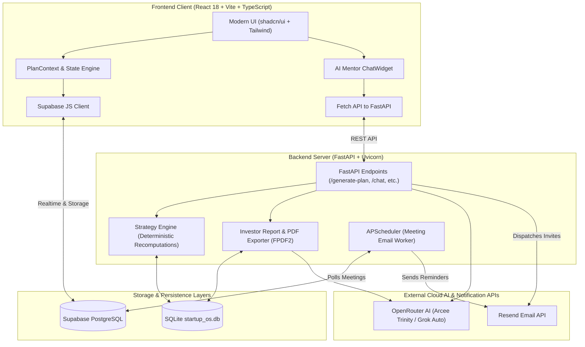
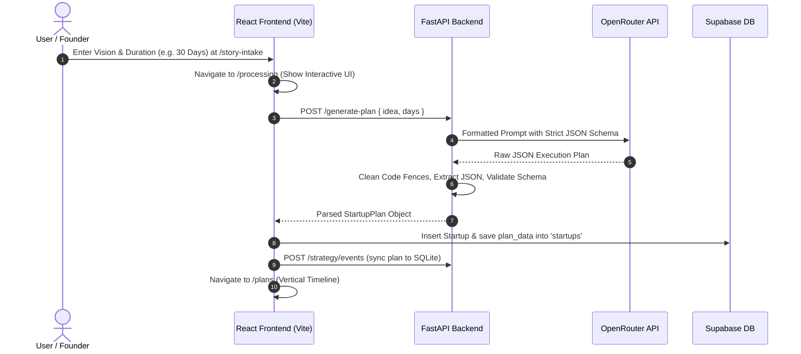
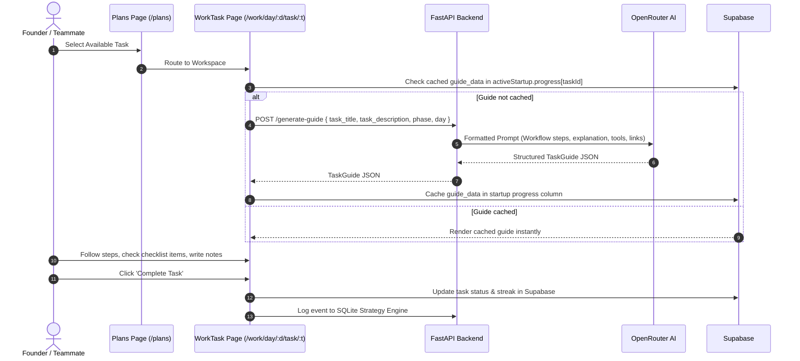
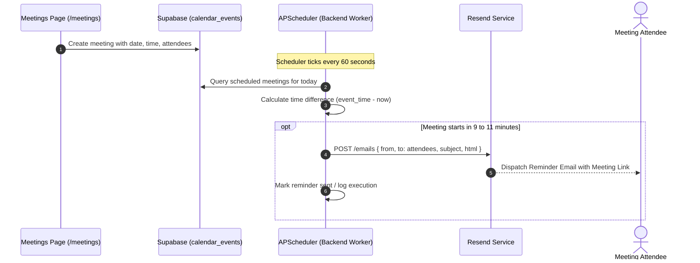

# DudeX AI 🚀 — Comprehensive System Architecture & Workflow Guide

> **Authoritative Technical Documentation & Master Blueprint**  
> *Target Stack: React 18, TypeScript, Tailwind CSS, Vite, Python FastAPI, Uvicorn, Supabase, SQLite, OpenRouter, Resend, APScheduler*

---

## 📑 Table of Contents
1. [Executive Overview & Mission](#1-executive-overview--mission)
2. [High-Level Architecture](#2-high-level-architecture)
3. [Dual-Database Architecture & Data Synchronization](#3-dual-database-architecture--data-synchronization)
4. [End-to-End User & System Workflows](#4-end-to-end-user--system-workflows)
5. [Complete Feature Inventory & Deep Dive](#5-complete-feature-inventory--deep-dive)
6. [Backend API Specifications](#6-backend-api-specifications)
7. [Database Schemas & Data Models](#7-database-schemas--data-models)
8. [Codebase Organization & Component Directory](#8-codebase-organization--component-directory)
9. [Security, Roles & Deterministic State Management](#9-security-roles--deterministic-state-management)
10. [Local Execution & Operational Guide](#10-local-execution--operational-guide)

---

## 1. Executive Overview & Mission

### 1.1 The Problem DudeX AI Solves
Early-stage founders and hackathon teams often suffer from **ideation paralysis** or **unstructured execution**. While founders can easily ideate, they struggle with:
- Deconstructing a high-level vision into tactical daily steps.
- Enforcing strict sequential dependency between validation, prototyping, and scaling.
- Tracking verifiable metrics, OKRs, and KPIs without manual spreadsheet maintenance.
- Keeping teams aligned on daily sprints, calendar schedules, and meetings.
- Generating investor-grade progress and execution narratives from raw execution history.

### 1.2 The DudeX AI Solution
**DudeX AI** is a production-grade, full-stack **Startup Operating System (OS)** that transforms raw startup ideas into structured, milestone-driven execution roadmaps. It blends generative artificial intelligence with deterministic execution metrics:
- **LLM-Powered Ideation & Roadmapping:** Translates founder goals into phased milestones (Validation $\rightarrow$ Build $\rightarrow$ Launch) with day-by-day tasks and step-by-step guides.
- **Deterministic Metric Engine:** Unlike systems that let LLMs guess progress, DudeX AI uses an **event-sourced execution engine** where actual user task completions calculate OKR progress, KPI movements, and sprint velocity.
- **Multi-Tenant Collaboration:** Role-Based Access Control (Founders, Co-founders, Team Members) allows teams to share workspaces, credentials vault, meeting links, and calendar milestones.
- **Investor Report Exporter:** Automatically synthesizes execution history into a formatted PDF investor report with an AI-curated narrative.

---

## 2. High-Level Architecture

The platform follows a decoupled, resilient client-server architecture:



---

## 3. Dual-Database Architecture & Data Synchronization

DudeX AI uses a hybrid data persistence model that balances real-time multi-user synchronization with deterministic event sourcing:

| Layer | Technology | Primary Responsibility | Data Handled |
| :--- | :--- | :--- | :--- |
| **Operational & Collaborative Data** | **Supabase (PostgreSQL + RLS)** | User identity, organizational hierarchy, real-time sync, and asset storage | `startups`, `user_roles`, `calendar_events`, `vault_items`, `community_posts`, `profiles`, storage buckets |
| **Strategic & Event-Sourced Data** | **Local SQLite (`startup_os.db`)** | Deterministic calculations, audit logging, OKRs, KPIs, and investor reporting | `plans`, `plan_okrs`, `plan_key_results`, `plan_kpis`, `plan_sprints`, `plan_risks`, `plan_assumptions`, `execution_events`, `computed_metrics` |

### Why This Dual Strategy Works:
1. **Zero Hallucination Metrics:** When a founder marks a task complete, an immutable `task_completed` event is recorded in the SQLite event log. The strategy engine computes overall progress, validation confidence, and sprint completion purely from deterministic mathematical formulas.
2. **Real-time Team Security:** Supabase provides Row-Level Security (RLS) ensuring team members only access startups and credentials they are invited to.

---

## 4. End-to-End User & System Workflows

### 4.1 Plan Creation & AI Decomposition Workflow



### 4.2 Daily Task Execution & Dynamic Guide Workflow



### 4.3 Automated Meeting Notifications Workflow



---

## 5. Complete Feature Inventory & Deep Dive

### 5.1 🧠 Intelligent Startup Plan Generator
- **User Input:** Founder vision statement + Planning timeframe ($7, 14, 30, 60, \text{or } 90\text{ days}$).
- **Decomposition:** Generates a structured multi-phase roadmap:
  - **Phase 1: Validation** (Customer interviews, competitor audits, market size estimation).
  - **Phase 2: Build** (MVP architecture, prototype development, user feedback loops).
  - **Phase 3: Launch** (Go-to-market execution, waitlist conversion, growth metrics).
- **Format Hardening:** Cleans markdown backticks, strips hallucinations, and employs regex match fallbacks to ensure $100\%$ valid JSON.

### 5.2 ⚡ Professional Execution Workspace (`/work/day/:day/task/:taskId`)
- **Actionable Steps:** Every task breaks down into sequential checklist steps with tools and examples.
- **Deep-Dive Guide:** Explains *why* the process is necessary and provides direct documentation links.
- **Notes & Progress Persistence:** Founders can write rich notes directly in the task card, preserved in Supabase.
- **Dependency Guard:** Tasks remain locked until their explicit prerequisites (`dependsOn`) are completed.

### 5.3 📊 Deterministic Strategy Engine & Analytics (`/dashboard/:planId`)
- **Key Performance Indicators (KPIs):** Dynamically adjusts metrics such as *Interviews Conducted*, *Validation Confidence*, and *MVP Build Progress*.
- **Objectives and Key Results (OKRs):** Maps high-level startup goals to measurable numeric milestones.
- **Weekly Sprint Tracking:** Automatically marks sprints as completed when all contained days are completed.
- **Risk & Assumption Matrix:** Tracks startup risks and assumption validation with impact assessments.

### 5.4 💬 Global Context-Aware AI Mentor (`ChatWidget.tsx`)
- **Omnipresent Floating Widget:** Available across all authenticated pages.
- **Context Injection:** Injects the startup's name, vision, current phase, active task, and completion metrics into every prompt.
- **Lightweight Markdown Renderer:** Renders code blocks, bullet points, numbered steps, bold text, and clickable URLs in the chat window.

### 5.5 📅 Calendar & Smart Meeting Manager (`/calendar`, `/meetings`)
- **Consolidated Timeline:** Combines task deadlines, phase milestones, and scheduled meetings in a calendar grid.
- **Instant Meeting Creation:** Founders can schedule video conferences or in-person syncs with automatic team invite dispatches.
- **Automated Expiration:** Automatically marks past meetings as `Completed` and filters out meetings older than 48 hours.

### 5.6 🔐 Startup Security Vault (`/vault`)
- **Password-Protected Storage:** Second-layer master password protection for startup secrets.
- **Secret Management:** Stores credentials, API keys, database connection strings, and sensitive links.
- **Instant Copy & Reveal:** Copy secrets to clipboard with toast notifications and toggle password visibility.

### 5.7 👥 Team Collaboration & RBAC (`/team`, `/organization`)
- **Three-Tier Roles:**
  - `founder`: Full administrative privileges, startup deletion, settings management.
  - `co_founder`: Plan editing, task completion, meeting creation, and team invites.
  - `member`: Read access, step participation, and community engagement.
- **Email Invitations:** Sends tokenized email invitations via the Resend API.

### 5.8 🌐 Startup Community (`/community`)
- **Founder Feed:** Public ecosystem for founders to share product launches, request feedback, and network.
- **Tagging & Filtering:** Categorized by `#engineering`, `#marketing`, `#fundraising`, and `#general`.

### 5.9 📄 Investor Report & PDF Exporter (`/export/investor-report/:planId`)
- **Evidence-Based Narrative:** Summarizes real execution stats (tasks completed, validation score, sprints).
- **Clean PDF Generation:** Formats markdown into a corporate-styled PDF with headers, footers, and page numbers via `fpdf2`.

---

## 6. Backend API Specifications

Base URL: `http://127.0.0.1:8000`

| Endpoint | Method | Input Payload | Output / Response | Description |
| :--- | :--- | :--- | :--- | :--- |
| `/` | `GET` | None | `{"status": "ok", "service": "DudeX AI"}` | Health check |
| `/generate-plan` | `POST` | `{"idea": str, "days": int}` | `StartupPlan` JSON | Generates phased execution roadmap |
| `/chat` | `POST` | `{"context": str, "message": str}` | `{"response": str}` | Startup mentor chat response |
| `/generate-guide` | `POST` | `{"task_title": str, "task_description": str, "phase": str, "day": int}` | `TaskGuide` JSON | Generates actionable step guide |
| `/send-invite` | `POST` | `{"to_email": str, "startup_name": str, "inviter_email": str, "invite_url": str, "token": str}` | `{"status": "success"}` | Sends team invite email via Resend |
| `/send-meeting-invites`| `POST` | `{"attendees": [str], "title": str, "date": str, "time": str, "link": str, ...}` | `{"status": "success"}` | Sends meeting notification emails |
| `/strategy/state/{plan_id}` | `GET` | URL param `plan_id` | `StateResponse` (KPIs, OKRs, Sprints, Risks, Assumptions) | Retrieves calculated strategy state |
| `/strategy/events` | `POST` | `{"event_type": str, "payload": dict}` | `{"status": "event_logged"}` | Logs execution event and triggers recalculation |
| `/export/investor-report/{plan_id}` | `POST` | URL param `plan_id` | `StreamingResponse` (PDF attachment) | Generates and downloads investor PDF |

---

## 7. Database Schemas & Data Models

### 7.1 Supabase Schema (PostgreSQL)

```sql
-- 1. Startups Core Table
CREATE TABLE public.startups (
    id UUID PRIMARY KEY DEFAULT gen_random_uuid(),
    name TEXT NOT NULL,
    description TEXT,
    vision TEXT,
    created_by UUID REFERENCES auth.users(id),
    organization_id UUID,
    plan_data JSONB,
    progress JSONB,
    created_at TIMESTAMP WITH TIME ZONE DEFAULT timezone('utc'::text, now())
);

-- 2. User Roles Table (RBAC)
CREATE TABLE public.user_roles (
    id UUID PRIMARY KEY DEFAULT gen_random_uuid(),
    user_id UUID REFERENCES auth.users(id),
    startup_id UUID REFERENCES public.startups(id) ON DELETE CASCADE,
    role TEXT CHECK (role IN ('founder', 'co_founder', 'member')),
    created_at TIMESTAMP WITH TIME ZONE DEFAULT timezone('utc'::text, now())
);

-- 3. Calendar & Meetings Table
CREATE TABLE public.calendar_events (
    id UUID PRIMARY KEY DEFAULT gen_random_uuid(),
    startup_id UUID REFERENCES public.startups(id) ON DELETE CASCADE,
    title TEXT NOT NULL,
    event_year INTEGER NOT NULL,
    event_month INTEGER NOT NULL,
    event_day INTEGER NOT NULL,
    event_time TEXT,
    event_type TEXT DEFAULT 'task',
    status TEXT DEFAULT 'Scheduled',
    attendees JSONB DEFAULT '[]'::jsonb,
    link_or_poster TEXT,
    created_at TIMESTAMP WITH TIME ZONE DEFAULT timezone('utc'::text, now())
);

-- 4. Vault Storage Table
CREATE TABLE public.vault_items (
    id UUID PRIMARY KEY DEFAULT gen_random_uuid(),
    startup_id UUID REFERENCES public.startups(id) ON DELETE CASCADE,
    name TEXT NOT NULL,
    type TEXT NOT NULL,
    value TEXT,
    metadata JSONB DEFAULT '{}'::jsonb,
    created_at TIMESTAMP WITH TIME ZONE DEFAULT timezone('utc'::text, now())
);
```

### 7.2 Strategy Engine Schema (`startup_os.db` SQLite)

```sql
CREATE TABLE plans (
    id TEXT PRIMARY KEY,
    title TEXT,
    summary TEXT,
    created_at TIMESTAMP DEFAULT CURRENT_TIMESTAMP,
    last_updated TIMESTAMP DEFAULT CURRENT_TIMESTAMP
);

CREATE TABLE plan_okrs (
    id TEXT PRIMARY KEY,
    plan_id TEXT REFERENCES plans(id),
    objective TEXT
);

CREATE TABLE plan_key_results (
    id TEXT PRIMARY KEY,
    okr_id TEXT REFERENCES plan_okrs(id),
    title TEXT,
    target_value REAL,
    current_value REAL
);

CREATE TABLE plan_kpis (
    id TEXT PRIMARY KEY,
    plan_id TEXT REFERENCES plans(id),
    name TEXT,
    value REAL,
    target REAL
);

CREATE TABLE plan_sprints (
    id TEXT PRIMARY KEY,
    plan_id TEXT REFERENCES plans(id),
    week_number INTEGER,
    goal TEXT,
    completed BOOLEAN DEFAULT 0
);

CREATE TABLE execution_events (
    id INTEGER PRIMARY KEY AUTOINCREMENT,
    plan_id TEXT REFERENCES plans(id),
    event_type TEXT,
    payload TEXT,
    created_at TIMESTAMP DEFAULT CURRENT_TIMESTAMP,
    processed BOOLEAN DEFAULT 0
);
```

---

## 8. Codebase Organization & Component Directory

```
Dudex-AI-main/
├── backend 1/                          # Python FastAPI Backend
│   ├── api/
│   │   ├── email_service.py           # Resend dispatch + APScheduler meeting worker
│   │   ├── export_router.py           # PDF report streaming endpoints
│   │   ├── openrouter.py              # OpenRouter AI LLM integration (Arcee / Grok)
│   │   └── strategy_router.py         # Strategy calculation endpoints
│   ├── services/
│   │   ├── pdf_exporter.py            # FPDF2 plain-text & markdown PDF renderer
│   │   ├── report_generator.py        # Database data aggregator for reports
│   │   ├── report_narrative.py        # LLM prompt for evidence-based investor report
│   │   └── strategy.py                # Deterministic calculation engine
│   ├── database.py                    # SQLite schema definition and connector
│   ├── main.py                        # FastAPI application setup, CORS, endpoints
│   ├── startup_os.db                  # Local SQLite database instance
│   └── requirements.txt               # Backend dependencies
│
├── frontend 1/                         # React 18 + TypeScript + Vite
│   ├── src/
│   │   ├── components/                # Reusable UI widgets
│   │   │   ├── ChatWidget.tsx         # Global AI Startup Mentor Chatbot
│   │   │   ├── MeetingNotifier.tsx    # In-app meeting countdown and alerts
│   │   │   ├── NavLayout.tsx          # Authenticated top-bar and navigation shell
│   │   │   └── ui/                    # shadcn/ui component primitives
│   │   ├── context/
│   │   │   ├── PlanContext.tsx        # Central plan execution state & recalculation
│   │   │   └── TeamContext.tsx        # Multi-user team member management
│   │   ├── hooks/
│   │   │   ├── useAuth.tsx            # Supabase user authentication lifecycle
│   │   │   └── useStartup.tsx         # Active startup selection & user roles
│   │   ├── lib/
│   │   │   ├── metricsEngine.ts       # Progress & learning velocity calculations
│   │   │   ├── strategyEngine.ts      # KPI/OKR progress derivations
│   │   │   └── planUtils.ts           # Plan validation and data structure helpers
│   │   ├── pages/                     # Application routes
│   │   │   ├── Landing.tsx            # Marketing homepage
│   │   │   ├── Auth.tsx               # Sign in / Sign up page
│   │   │   ├── HomeSelection.tsx      # Startup selector / New venture launcher
│   │   │   ├── StoryIntake.tsx        # Idea intake form with timeline selector
│   │   │   ├── Processing.tsx         # Real-time animated AI generation view
│   │   │   ├── Plans.tsx              # Vertical timeline & milestone roadmaps
│   │   │   ├── WorkTask.tsx           # Interactive daily execution workspace
│   │   │   ├── StartupDashboard.tsx   # Strategic KPI/OKR dashboard
│   │   │   ├── CalendarView.tsx       # Calendar grid view of deadlines & events
│   │   │   ├── Meetings.tsx           # Video conference & sync scheduler
│   │   │   ├── Vault.tsx              # Password-protected credentials vault
│   │   │   ├── TeamDetailsPage.tsx    # Organization members & role assignments
│   │   │   └── Community.tsx          # Public founder forum
│   │   └── App.tsx                    # Route definitions, guards, and providers
│   ├── package.json                   # Frontend npm packages
│   └── vite.config.ts                 # Vite bundler configuration (port 8080)
│
├── start.bat                          # Simple Windows launcher
└── start_all_fixed.bat                # Automated multi-window launcher
```

---

## 9. Security, Roles & Deterministic State Management

### 9.1 Role-Based Access Control (RBAC)
- All startup access is gated through `user_roles`.
- Founders and Co-founders have exclusive rights to:
  - Mark daily tasks complete or unlocked.
  - Recompute strategy milestones.
  - Add or revoke team credentials in the Vault.
  - Send email invitations to new teammates.

### 9.2 Eliminating LLM Hallucinations in Execution Metrics
A major design flaw in pure AI systems is the tendency of LLMs to generate arbitrary numbers when asked "How is the startup doing?". 
**DudeX AI resolves this through strict separation of concerns:**
$$\text{Progress} = \frac{\sum \text{Completed Tasks}}{\sum \text{Total Tasks}} \times 100$$
$$\text{Validation Score} = \frac{\sum \text{Completed Validation Tasks}}{\sum \text{Validation Tasks}} \times 100$$
- The LLM is used **only** for creative ideation, structured task decomposition, and narrative generation.
- All numbers, KPIs, OKR target values, and completion percentages are calculated through deterministic algorithms in `metricsEngine.ts` and `services/strategy.py`.

---

## 10. Local Execution & Operational Guide

### 10.1 Quick Launch
Double-click [start_all_fixed.bat](file:///e:/Downloads/Dudex-AI-hackathon/Dudex-AI-main/start_all_fixed.bat) in the root directory.

### 10.2 Manual Command Execution

#### Backend Terminal:
```powershell
cd "e:\Downloads\Dudex-AI-hackathon\Dudex-AI-main\backend 1"
.\venv\Scripts\activate
python -m uvicorn main:app --reload --host 127.0.0.1 --port 8000
```
- API Endpoint: `http://127.0.0.1:8000`
- Swagger UI Documentation: `http://127.0.0.1:8000/docs`

#### Frontend Terminal:
```powershell
cd "e:\Downloads\Dudex-AI-hackathon\Dudex-AI-main\frontend 1"
npm run dev
```
- Frontend Web App: `http://localhost:8080`
