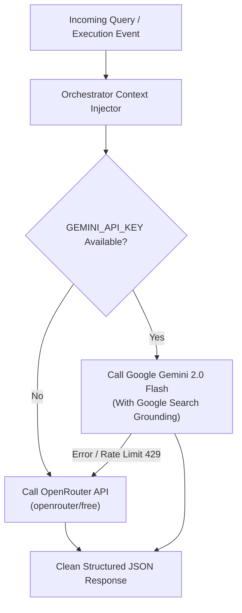

# Multi-Agent Orchestrator & Context Router

## 🎯 Purpose
The **Orchestrator** is the brain of DudeX AI. It sits between user requests and the 3 specialized autonomous agents:
1. **Analyzing Agent** (`AGENT_ANALYZING.md`): Market, competitors, TAM/SAM/SOM, and validation tests.
2. **Marketing Agent** (`AGENT_MARKETING.md`): GTM strategy, YC sales playbook, ICE growth experiments, Apollo leads, and Slack alerts.
3. **Operations Agent** (`AGENT_OPERATIONS.md`): Resend emails, Jitsi meetings, calendar events, and social copy.

---

## 🔄 Dual-Engine Provider Architecture



---

## 📦 Standard Context Envelope

Every agent invocation is wrapped in this standardized context payload extracted from active project state:

```json
{
  "startup_id": "uuid-here",
  "startup_name": "DudeX AI",
  "vision": "Raw founder vision statement",
  "current_phase": "Validation | Build | Launch | Scale",
  "current_day": 7,
  "completed_tasks_count": 5,
  "overall_progress_percent": 18.5,
  "active_kpis": [],
  "user_query": "Find me my direct competitors and tell me how to get my first 5 customers."
}
```

---

## 🚦 Routing Heuristics

1. **Query contains "competitor", "market", "alternative", "TAM", "industry", "who else"**:
   $\longrightarrow$ Route to **Analyzing Agent** with Google Search Grounding tool enabled.
2. **Query contains "marketing", "customers", "leads", "sales", "outreach", "apollo", "ice", "growth"**:
   $\longrightarrow$ Route to **Marketing Agent** with embedded YC Sales & HubSpot GTM playbooks.
3. **Query contains "email", "meeting", "schedule", "post", "tweet", "linkedin", "jitsi", "calendar"**:
   $\longrightarrow$ Route to **Operations & Communications Agent**.
4. **General Startup Ideation / Execution Query**:
   $\longrightarrow$ Parallel Fan-out: Invoke Analyzing + Marketing Agents concurrently and merge strategic outputs.
